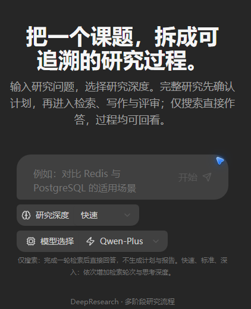

# ZB02 DeepResearch

面向需要检索、对比和论证的复杂问题，提供从需求澄清、计划确认到检索、写作与评审的完整研究流程。后端使用 LangGraph 编排多阶段 Agent，前端呈现流式过程、计划确认、历史回看与断点续跑；PostgreSQL、Redis、Milvus 与前后端服务由 Docker Compose 统一部署。



## 核心能力

- **需求澄清**：首次提交先由澄清器逐题确认研究边界，最多 3 个问题，每题提供 2–4 个可选项，支持自填和跳过。确认后的约束随课题进入计划生成，降低方向偏差。
- **计划先行**：先生成研究计划，经用户确认后才进入检索与写作。计划未确认时，任务不会启动。
- **多阶段流水线**：计划生成 → 计划确认 → 查询生成 → 网络检索 → 反思 → 提纲 → 初稿 → 评审 → 修订 → 引用润色 → 定稿。
- **流式反馈**：SSE 推送节点进度与逐 token 输出，前端实时展示当前阶段、中间产物和耗时。
- **状态可见**：任务进行中持续显示当前阶段、已运行时长、最近事件距今时间；超过 90 秒无新进展时提示当前可能停滞的阶段，超过 5 分钟给出停止或从历史续跑的入口。历史详情对运行中任务每 3 秒刷新阶段与步骤。
- **中断恢复**：后端启动时会把上一进程遗留的 `running` 任务标记为 `failed`，保留最后阶段并标注“服务重启中断”，避免历史列表长期显示“进行中”。
- **逐节点持久化**：每个节点完成后写入 `research_steps`；历史详情按执行顺序还原中间产物，可直接查看任务停在哪一步、已经产出了什么。
- **历史与续跑**：历史记录按用户隔离，支持查看完整步骤；暂停或失败的任务可从原 `thread_id` 继续，无需从头重跑。历史记录支持删除，删除会同时清理步骤快照、用户关联、Redis 事件流与 LangGraph checkpoint。
- **登录与会话**：HttpOnly Cookie + Redis session；登录页支持“记住我”，勾选后用户名自动回填，会话延长到 30 天。
- **可选知识库**：启用 Milvus profile 后，检索结果可沉淀为事实并参与后续研究，支持时效性策略与重排序。
- **多模型接入**：兼容 OpenAI 协议，模型列表由 `AVAILABLE_MODELS` 配置，前端下拉动态读取。
- **服务端密钥**：LLM、Embedding、MCP 的 Key 只存在于后端 `.env`，不会进入前端 bundle。

## 技术栈

| 层次 | 选型 |
| --- | --- |
| 前端 | React 19、TypeScript、Vite、Tailwind CSS、Radix UI |
| 后端 | FastAPI、LangGraph、Pydantic、SQLAlchemy Async、Uvicorn |
| 任务与事件 | Redis Streams（任务队列、SSE 事件流、LangGraph checkpoint） |
| 关系存储 | PostgreSQL 16（用户、历史记录、步骤快照） |
| 向量检索 | Milvus 2.6（可选 profile） |
| 模型与工具 | DashScope OpenAI 兼容端点、百炼 MCP 应用、gte-rerank |
| 部署 | Docker Compose、Nginx |

## 架构

```text
Browser
  │
  ▼
Nginx :12309
  │  /api 反向代理
  ▼
FastAPI :12409（uvicorn agent.app:app）
  ├─ LangGraph 研究流水线
  ├─ Redis Streams：任务队列 / 事件流 / checkpoint
  ├─ PostgreSQL：用户、research_records、research_steps
  └─ Milvus（可选）：研究事实库
```

关键约定：

- 后端是自建 FastAPI 服务，不是 `langgraph dev`。因此不存在 `/threads`、`/runs`、`/assistants` 等 LangGraph 原生端点，前端主链路统一走 `/api/research` + SSE。
- 任务提交后先入 Redis Stream，后台 worker 消费；SSE 端点按 `Last-Event-ID` 回放，刷新或短暂断线不会丢事件。
- LangGraph checkpoint 存在 Redis，用于暂停后继续；PostgreSQL 只保存面向用户的历史事实，二者职责分离。
- 认证使用 HttpOnly Cookie + Redis session，后端中间件统一拦截未登录请求。
- 当前是单机、单进程 worker，同一时刻只执行 1 个研究任务；多人同时提交会排队，容量边界见[架构审查](docs/架构审查-2026-11-17.md)。

## 快速启动

前置条件：Docker Desktop 已启动，宿主机端口 `12309`、`12409`、`12509`、`12609` 未被占用。

```powershell
cd "C:\FinalProjectYeb\ZB02 Deepresearch"

# 1. 准备后端配置
Copy-Item backend\.env.example backend\.env

# 2. 填写 backend\.env 中的 Key 与端点（至少 APP_TOKEN、LLM_BASE_URL、DASHSCOPE_API_KEY、MCP_APP_ID）

# 3. 启动核心服务
docker compose up -d --build

# 4. 打开前端
# http://localhost:12309/app/
```

开发环境内置测试账号（首次启动自动建表）：

| 用户名 | 密码 |
| --- | --- |
| zhangsan | zhangsan |
| lisi | lisi |

常用运维命令：

```powershell
# 查看状态
docker compose ps

# 查看后端日志
docker compose logs -f backend

# 修改 .env 后重建后端
docker compose up -d --force-recreate backend

# 连同 Milvus 知识库启动
docker compose --profile kb up -d --build

# 停止但保留数据卷
docker compose down

# 停止并清空全部数据（谨慎）
docker compose down -v
```

端口分配：

| 服务 | 宿主机 | 容器 |
| --- | --- | --- |
| 前端 | 12309 | 80 |
| 后端 | 12409 | 2024 |
| PostgreSQL | 12509 | 5432 |
| Redis Stack | 12609 | 6379 |
| Milvus | 19509 | 19530 |

## 配置说明

所有服务端配置集中在 `backend/.env`，模板见 `backend/.env.example`。

| 变量 | 说明 |
| --- | --- |
| `APP_TOKEN` | LLM 服务 API Key |
| `LLM_BASE_URL` | OpenAI 兼容端点，例如 `https://dashscope.aliyuncs.com/compatible-mode/v1` |
| `LLM_REASONING_EFFORT` | 兼容旧配置的思考档位，建议设为 `off`；新配置优先使用 `LLM_THINKING_LEVEL` |
| `LLM_THINKING_LEVEL` | 默认思考深度：`off` / `standard` / `deep`；默认 `off`，尽量关闭思维链 |
| `SEARCH_SUMMARY_MODEL` | 查询生成与 MCP 结果摘要模型，默认 `qwen3.8-flash`；和最终写作模型解耦 |
| `REVIEW_MODEL` | 评审/评估专用模型，默认 `deepseek-v4.1-flash`；反思评估和初稿评审走 DeepSeek，常规生成仍用 Qwen |
| `LLM_REQUEST_TIMEOUT` | 单次 LLM 请求超时秒数，默认 `240`；超时后按重试策略返回，不会无限停留在处理状态 |
| `DASHSCOPE_API_KEY` | 百炼 / DashScope Key；不填时回退到 `APP_TOKEN` |
| `MCP_APP_ID` | 百炼 MCP 应用 ID，用于 Web 搜索 |
| `EMBEDDING_API_KEY` / `EMBEDDING_BASE_URL` / `EMBEDDING_MODEL` | 向量化服务配置，默认 1024 维 |
| `AVAILABLE_MODELS` | 前端模型下拉的 JSON 数组，需与后端可用模型一致；可用 `is_default` 标记默认模型 |
| `DEFAULT_MODEL_ID` | 显式默认模型，必须出现在 `AVAILABLE_MODELS` 中；未配置时取 `is_default` 或列表第一项 |
| `DATABASE_URL` | PostgreSQL 连接串；Compose 内主机名为 `postgres` |
| `REDIS_URL` | Redis 连接串；Compose 内主机名为 `redis` |
| `MILVUS_URI` | Milvus 地址；未启用知识库时可不配 |
| `KB_LIFECYCLE_MODE` | 知识库时效策略：`off` / `inform` / `freshness` / `lifecycle` |
| `RERANKER_KB_ENABLED` / `RERANKER_WEB_ENABLED` | 知识库与 Web 结果的精排开关 |
| `NUMBER_OF_INITIAL_QUERIES` / `MAX_RESEARCH_LOOPS` | 首轮查询数与最大研究轮数 |

前端只保留一个“研究深度”下拉，并同步映射模型思考档位：仅搜索不生成计划、提纲和审稿，完成一轮检索后直接回答；快速、标准、深入分别对应关闭、标准、深入三档思考。后端按 Qwen / DeepSeek 的厂商字段自动换算，前端不暴露各厂商不同的档位命名；API 调用方仍可显式传入 `thinking_level`。

搜索 MCP 结果进入 LLM 前会先去重、清洗 URL、截断 snippet 并控制总字符预算；查询生成与摘要默认使用 `qwen3.8-flash`，使搜索中间层与最终写作模型解耦。查询生成和反思后的 follow-up 查询都会去空、去重、取首句并截断到 120 字；检索节点不再把查询写回全局查询列表，避免同一查询在状态与界面中重复出现。

前端不保存任何 API Key。Nginx 只负责静态资源与 `/api` 反向代理。

## 目录结构

```text
ZB02 Deepresearch/
├── backend/
│   ├── src/agent/
│   │   ├── app.py                 # FastAPI 入口、认证、历史与 SSE 路由
│   │   ├── task_queue.py          # Redis Streams 任务队列、逐节点落库
│   │   ├── graph.py               # LangGraph 主图与条件路由
│   │   ├── base_agent.py          # Agent / JSON Agent / MCP / Web 搜索基类
│   │   ├── prompts.py             # 计划、查询、反思、写作、评审提示词
│   │   ├── db/                    # 用户、历史记录、步骤快照模型
│   │   ├── auth/                  # Cookie session 认证
│   │   ├── kb/                    # Milvus 事实库与生命周期
│   │   └── llm/                   # OpenAI 兼容客户端
│   ├── scripts/                   # 历史回填等运维脚本
│   ├── eval/                      # 评估框架与数据集
│   ├── test/                      # 后端测试
│   ├── .env.example
│   └── Dockerfile
├── frontend/
│   ├── src/
│   │   ├── components/            # 欢迎页、输入区、历史列表与详情、时间线
│   │   ├── lib/                   # API 封装、研究流 Hook
│   │   ├── App.tsx
│   │   └── global.css
│   ├── nginx.conf
│   └── Dockerfile
├── docs/                          # 测试、安全、评估、ADR、工作量与截图
├── docker-compose.yml
├── Docker使用说明.md
└── README.md
```

## API

除登录外，接口均要求有效会话 Cookie。

| 方法 | 路径 | 用途 |
| --- | --- | --- |
| `POST` | `/api/login` | 用户名密码登录，写入 HttpOnly Cookie；`remember=true` 时会话延长到 30 天 |
| `POST` | `/api/logout` | 注销当前会话 |
| `GET` | `/api/whoami` | 返回当前登录用户 |
| `GET` | `/api/models` | 返回 `AVAILABLE_MODELS` 配置的模型列表 |
| `POST` | `/api/research` | 提交研究任务，立即返回 `task_id` 与 `stream_url` |
| `POST` | `/api/clarify` | 逐题需求澄清：传入原始课题与已答列表，一次返回一个带选项的关键问题 |
| `GET` | `/api/research/{task_id}/stream` | SSE 事件流，支持 `Last-Event-ID` 续传 |
| `GET` | `/api/history` | 当前用户最近 50 条研究记录 |
| `GET` | `/api/history/{thread_id}` | 单条研究详情与全部步骤快照 |
| `DELETE` | `/api/history/{thread_id}` | 删除当前用户的研究记录、步骤与运行时状态 |

`POST /api/research` 请求体示例：

```json
{
  "messages": [{ "type": "human", "content": "对比 Redis 与 PostgreSQL 的适用场景" }],
  "initial_search_query_count": 2,
  "max_research_loops": 2,
  "reasoning_model": "qwen-plus-latest",
  "thinking_level": "off",
  "research_mode": "report",
  "plan_status": "confirmed",
  "plan": "已有的研究计划",
  "task_id": "需要续跑时回传原 thread_id"
}
```

## 关键设计

### 逐题需求澄清

首次提交先请求 `/api/clarify`。澄清器只在存在会改变研究范围或结论的歧义时提问，一次只返回一个问题和 2–4 个具体选项，前端按 A/B/C/D 渲染；用户可点选、填写“其他”，或跳过直接按原问题研究。最多 3 轮，已答内容以 `【需求澄清补充】` 附加到原始课题，再进入计划生成。澄清器使用 `qwen3.8-flash`，不占用评审模型。

### 仅搜索问答

研究深度选择“仅搜索”时，请求体带 `research_mode: "search"`。图入口直接进入研究子图，不生成计划、不等待人工确认；最多执行 1 轮“生成查询 → 并行网络检索 → 反思”，然后由 `quick_answer` 节点基于检索摘要生成 200–500 字的常规问答回答，并保留正文内可点击来源链接。该模式仍会经过搜索归一化、去重和摘要事实约束，但不写提纲、不生成初稿、不做审稿与润色，适合单事实确认、名词解释和轻量追问。

### 计划确认与断点续跑

首次提交只生成计划并暂停。前端展示计划后，用户点击确认，客户端携带 `plan`、`plan_status=confirmed` 与同一个 `task_id` 再次提交。后端复用 Redis 中的 LangGraph checkpoint，不新建任务，也不会重复生成空计划。

### 逐节点持久化

`task_queue._process_one_task` 每消费一个节点完成事件，就调用 `_persist_research_step()`：

- `research_steps` 追加一条节点快照，唯一约束为 `(thread_id, seq)`，重复消费不会写重。
- `research_records` 同步更新 `stage`、`stage_label`、`step_count`、`status`。
- 空输出节点直接跳过，避免续跑时出现重复的空步骤。

因此 PostgreSQL 保存的是面向用户的研究档案，Redis 保存的是可继续执行的 checkpoint。即使 Redis 过期，历史详情仍然完整，只是无法再从该 checkpoint 续跑。

历史删除采用硬删除：`DELETE /api/history/{thread_id}` 在一次数据库事务中删除 `research_steps`、`user_threads`、`research_records`，提交后再清理 Redis 事件流、事件游标、任务互斥锁和 LangGraph checkpoint。`running` 状态的记录返回 `409`，避免删除仍在执行的任务；Redis 清理失败只记录告警，不回滚已经完成的历史删除。

### 任务队列与事件流

- Redis Streams 承担入队、消费与事件回放；SSE 只负责把事件推给浏览器。
- 每个任务有独立的 `research:events:{task_id}` 事件流，保留 24 小时。
- 浏览器短暂断线后可通过 `Last-Event-ID` 从上次位置继续读取。
- 前端根据事件流维护 `phase / startedAt / lastEventAt / eventCount`，用于持续显示当前阶段和停滞判断；历史详情对 `running` 记录轮询刷新，不依赖 SSE 是否仍连接。
- 后端 lifespan 启动时调用 `mark_running_tasks_interrupted()`：上一进程被重启或崩溃时，遗留的 `running` 记录会变成 `failed`，`stage_label` 保留为“最后阶段（服务重启中断）”，历史里能直接看到停在哪一步。该恢复只改状态，不删除步骤或报告。

### 引用与评估

写作阶段要求模型输出带来源引用的报告；检索结果不足时会在报告中显式说明。`backend/eval/` 提供批量评估脚本与指标记录，评估结果落为 JSON，便于对比不同模型与提示词版本。

## 数据备份与恢复

历史数据都在 PostgreSQL 的 `pgdata` 卷中：

```powershell
docker exec zb02-deepresearch-postgres-1 pg_dump -U postgres -d deepresearch > deepresearch_backup.sql
```

恢复：

```powershell
Get-Content deepresearch_backup.sql | docker exec -i zb02-deepresearch-postgres-1 psql -U postgres -d deepresearch
```

只要不执行 `docker compose down -v`，PostgreSQL、Redis、Milvus 的数据卷都会保留。

旧任务回填脚本可将 Redis 中已有的事件流重放为历史记录，支持幂等执行：

```powershell
docker exec -w /app zb02-deepresearch-backend-1 python -m scripts.backfill_history
```

## 文档索引

- [Docker 使用说明](Docker使用说明.md)：启动、端口、历史持久化、备份、已知限制
- [架构审查 2026-11-17](docs/架构审查-2026-11-17.md)：NFR、故障模式、风险清单与修复顺序
- [测试指引](docs/测试指引.md)
- [评估框架](docs/评估框架ReadMe.md)
- [大模型安全设计](docs/大模型安全设计.md)
- [工程投入与工作量评估](docs/项目工作量.md)
- [前端代码架构](frontend/前端代码架构.md)
- [模型配置说明](backend/模型配置说明.md)
- [架构决策记录](docs/架构决策ADR/)（001–013）

## 已知边界

- 百炼“应用”返回的是成文分析，不是结构化搜索结果，解析器只能从文本中抽取链接；单次查询常见 0–2 条来源，报告引用数量偏少。需要更稳定的来源覆盖时，应替换为独立搜索 API。
- 后端未启用 FastAPI 自带的 `/docs` 与 `/redoc`，对外契约以本文档和路由代码为准。
- `MAX_RESEARCH_LOOPS`、`NUMBER_OF_INITIAL_QUERIES` 以 `.env` 为准，请求体同名字段不保证覆盖。
- 前端使用 `BrowserRouter` 且未设置 `basename`；`/login` 由 Nginx 单独兜底，新增前端路由时需同步检查 Nginx 配置。
- 当前为单机 Compose 部署，未包含 CI/CD、压测、生产级监控与多副本编排。
- 单进程 worker 同一时刻只执行 1 个研究任务；队列 pending 回收尚未实现，进程在任务执行中崩溃会留下未确认消息。
- 任务所有权校验尚未实现：`POST /api/research` 与 SSE 订阅当前不校验 `task_id` 是否属于当前用户，修复方案见 [ADR-013](docs/架构决策ADR/013-task-ownership-and-queue-reclaim.md)。
- Compose 将 PostgreSQL、Redis、Milvus 端口发布到 `0.0.0.0`，默认使用镜像凭据。仅在可信本机环境使用；接入共享网络前应按架构审查 AR-05 改绑本机并替换凭据。
