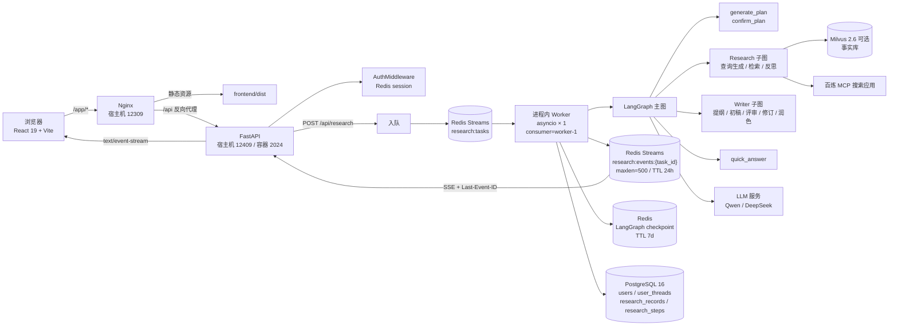

# ZB02 DeepResearch 架构审查

> 审查日期：2026-11-17  
> 审查范围：系统架构、非功能需求、可靠性、安全、可维护性、文档一致性  
> 审查方式：代码走查 + Docker Compose 配置核对 + 运行时取证 + 文档对照  
> 关联材料：[前端全站审计](frontend-audit-2026-11-17.md)、[ADR-013](架构决策ADR/013-task-ownership-and-queue-reclaim.md)

## 结论摘要

当前架构与项目定位基本匹配：单机 Docker Compose、FastAPI 模块化单体、LangGraph 主图加研究/写作子图、Redis Streams 承担任务队列与事件流。对单用户、内部使用、单机部署的场景，这套结构没有明显过度设计，组件职责也基本清楚。

问题不在“架构选型”，而在边界收口。任务所有权、队列 pending 回收、SSE 生命周期、默认凭据与端口暴露这几处，已经影响到了多用户隔离和故障恢复的实际可信度。文档层面则存在一批过期统计和过期描述，会直接误导评审人。

| 维度 | 结论 | 主要依据 |
| --- | --- | --- |
| 架构适配性 | 合格 | 模块化单体 + 异步任务队列，匹配单人维护和单机部署 |
| 功能完整性 | 基本合格 | 澄清、计划确认、检索、写作、评审、历史、续跑均有实现 |
| 可靠性 | 不合格 | 3 条 pending 消息滞留 6.6–7.9 小时，无回收机制 |
| 安全 | 不合格 | 任务所有权缺失，构成可确认的 IDOR；默认凭据与端口暴露 |
| 可维护性 | 中等 | 代码边界较清楚，但文档漂移、无 CI、测试不可复现 |
| 可观测性 | 偏弱 | 只有日志，没有任务状态指标、队列积压告警或 pending 告警 |
| 容量 | 单任务 | 单进程内一个 worker，同一时刻只执行 1 个研究任务 |

必须优先处理的三件事：

1. 给 `POST /api/research` 与 `GET /api/research/{task_id}/stream` 补任务所有权校验，禁止覆盖历史记录的 `user_id`。
2. 给 Redis Streams 补 pending 回收，至少保证进程重启后不留下永久 pending。
3. 把局域网暴露面收回来：数据库、缓存、向量库端口默认只绑本机；初始化弱口令账号改为显式开关。

---

## 一、需求与约束

### 1.1 功能需求

| 能力 | 实现位置 | 状态 |
| --- | --- | --- |
| 登录、登出、会话校验 | `auth/routes.py`、`auth/middleware.py`、`auth/session.py` | 已实现 |
| 逐题需求澄清 | `/api/clarify`、`frontend/src/App.tsx` | 已实现 |
| 计划生成与人工确认 | `graph.py` 的 `generate_plan` / `confirm_plan`，前端计划卡 | 已实现 |
| 异步任务入队与执行 | `POST /api/research`、`task_queue.py` | 已实现 |
| SSE 过程推送 | `/api/research/{task_id}/stream`、`read_task_events` | 已实现，生命周期有缺口 |
| 仅搜索问答 | `research_mode=search`、`quick_answer` 节点 | 已实现 |
| 历史列表与详情 | `/api/history`、`/api/history/{thread_id}` | 已实现 |
| 步骤快照 | `research_steps`、`_persist_research_step` | 已实现 |
| 暂停/失败后续跑 | Redis checkpoint + 同一 `task_id` 重新入队 | 已实现 |
| 历史删除 | `DELETE /api/history/{thread_id}` | 已实现 |
| 可选知识库 | Milvus profile、`kb/` | 已实现，默认关闭 |
| 批量评估 | `backend/eval/` | 已实现，未接入 CI |

### 1.2 非功能需求

下表的目标值按“内部单机、1–5 名已知用户”的实际场景设定，不按公网产品规模设定。

| 类别 | 当前可确认值 | 建议目标 | 差距 |
| --- | --- | --- | --- |
| 并发 | 1 个活跃研究任务；1 个 `worker-1` consumer | 单机 1–2 个并发任务，超出的任务排队 | 单 worker 无法达到 2 个并发 |
| 队列时延 | 未测；3 条 pending 已滞留 6.6–7.9 小时 | 排队任务在 1 个任务时长内开始执行 | 无 pending 回收，时延无上界 |
| API 响应 | 健康检查正常；未做 p95 统计 | 非 LLM 接口 p95 < 300ms | 无指标，无法验收 |
| SSE 首包 | 未测 | 建立连接后 2s 内收到首条事件或心跳 | 无心跳，空闲连接会被 Nginx 断开 |
| 页面加载 | 最近构建主包 462.42KB / gzip 146.59KB | 局域网首屏 < 2s | 未做真实网络测量 |
| 可用性 | 单机、单副本，无自动重启策略以外的冗余 | 内部工具 99%（年停机约 3.65 天） | 单点故障，重启期间任务不可用 |
| 数据可靠性 | PostgreSQL 数据卷；手工 `pg_dump` | RPO 24h、RTO 1h | 无自动备份、无恢复演练记录 |
| 安全 | Cookie session，无 RBAC；默认凭据；端口绑定 `0.0.0.0` | 每个用户只能访问自己的任务；默认凭据不进入共享环境 | 所有权校验缺失，见 AR-01 |
| 可维护性 | 90 个源文件、15,197 行；无 CI | 文档与代码一致；测试可在干净环境重跑 | 测试环境缺 pytest，文档统计过期 |
| 成本 | 单台 Windows 主机 + Docker Desktop | 不新增云资源 | 符合当前预算 |

### 1.3 约束

- 单人研发、约 11 个月周期，维护精力有限。
- 部署形态是单机 Compose，不引入 Kubernetes、消息中间件或独立 worker 集群。
- ADR_README 已明确把 CI/CD、分布式追踪、灰度发布、多租户、公网安全防护排除在决策范围外。
- “排除在 ADR 范围”不等于“可以默认暴露”。当前服务已经绑定到 `0.0.0.0`，同一局域网内可访问，默认凭据与无鉴权 Redis 就属于实际风险，不是假想风险。

---

## 二、架构现状

### 2.1 组件图



### 2.2 组件职责

| 组件 | 职责 | 关键约束 |
| --- | --- | --- |
| Nginx | 静态站点、`/api` 反代、SSE 透传 | `proxy_read_timeout 300s`、`proxy_buffering off` |
| FastAPI | 认证、澄清、任务提交、SSE、历史 CRUD | 不是 `langgraph dev`，没有 `/threads`、`/runs`、`/assistants` 原生端点 |
| AuthMiddleware | Cookie → Redis session → `request.state.user_id` | 白名单仅登录、登出、whoami、models |
| Worker | 从 Redis Streams 取任务，驱动 LangGraph，写事件与步骤 | 运行在 FastAPI lifespan 内，单进程单协程消费 |
| LangGraph 主图 | 计划、确认、研究、写作、快速回答的路由 | checkpoint 存 Redis，`thread_id=task_id` |
| PostgreSQL | 用户、用户线程关联、研究记录、步骤快照 | 面向用户的历史事实来源 |
| Redis Streams | 任务队列、事件流、事件游标、任务互斥锁 | 同时承担三种职责，耦合度高 |
| Milvus | 可选事实库与语义检索 | 默认不启动，依赖 etcd + MinIO |
| LLM / MCP | 查询生成、摘要、写作、评审、搜索 | 外部依赖，超时与限流是主要故障源 |

### 2.3 状态归属

| 数据 | 主存储 | 生命周期 | 一致性说明 |
| --- | --- | --- | --- |
| 登录会话 | Redis `session:{id}` | 24h / 30d | Redis 丢失即全体登出 |
| 待执行任务 | Redis `research:tasks` | 直到 XACK | 无 pending 回收 |
| 过程事件 | Redis `research:events:{task_id}` | 24h，最多 500 条 | 长报告可能挤掉早期事件 |
| 图执行状态 | Redis checkpoint | 7d | 过期后不能续跑，但历史步骤仍在 |
| 历史记录 | PostgreSQL `research_records` | 持久 | `thread_id` 全局唯一 |
| 步骤快照 | PostgreSQL `research_steps` | 持久 | `(thread_id, seq)` 唯一 |
| 用户与线程关联 | PostgreSQL `user_threads` | 持久 | `(user_id, thread_id)` 唯一 |
| 知识库事实 | Milvus | 按生命周期策略 | 可选，失败时降级 |

### 2.4 主流程

1. 浏览器提交问题，前端先调用 `/api/clarify` 完成最多 3 轮澄清。
2. 前端 `POST /api/research`，后端生成或复用 `task_id`，写入 `research:tasks`，同时写入 `user_threads`。
3. Worker 用 `XREADGROUP` 取任务，建立 `research:active:{task_id}` 互斥锁，驱动 LangGraph。
4. 每个节点完成事件写入 `research:events:{task_id}`；token 也写入同一事件流。
5. 前端用 `EventSource` 订阅 `/api/research/{task_id}/stream`，按事件更新阶段、时间线和正文。
6. 计划生成后写 `task_paused`，前端展示计划；用户确认后带同一 `task_id` 再次提交，复用 checkpoint 继续。
7. 每个节点完成时写 `research_steps`，同步更新 `research_records` 的阶段、步骤数和状态。
8. 任务结束或暂停时 `XACK`，删除互斥锁，给事件流设置 24h 过期。

---

## 三、关键决策与取舍

| 决策 | 备选方案 | 选择理由 | 代价 |
| --- | --- | --- | --- |
| 模块化单体 FastAPI | 微服务拆分 | 单人维护、单机部署、调试链路短 | 无法按组件独立扩容，进程内 worker 与 API 共享生命周期 |
| Redis Streams 同时做队列、事件流、checkpoint | Celery + 独立消息队列；Postgres 轮询 | 少一个中间件，XADD/XREAD 与 SSE 回放天然契合 | 队列语义与事件语义耦合；pending 回收、maxlen、TTL 需要自己维护 |
| PostgreSQL 保存用户可见历史 | 全部状态放 Redis | 历史可查询、可审计，Redis 过期不影响档案 | 两套状态需要同步，异常时可能出现“库里有记录、队列里没消息” |
| HITL 计划确认复用同一 `task_id` | 新建子任务或独立确认接口 | 直接复用 LangGraph checkpoint，逻辑简单 | `task_id` 由客户端回传，必须补所有权校验，否则成为越权入口 |
| Worker 跑在 FastAPI lifespan 内 | 独立 worker 容器 | 部署简单，不增加服务 | API 重启即 worker 重启；单进程只能跑一个任务；多副本 consumer 名冲突 |
| Milvus 作为可选 profile | 默认启动；或不做 KB | 默认不增加 etcd/MinIO 运维负担 | KB 能力默认不可用，启用后多三个容器 |
| HttpOnly Cookie + Redis session | JWT；OAuth | 实现简单，登出可立即失效 | 依赖 Redis；无 Secure 标志；无登录限速 |

这些决策分别对应 ADR-001 至 ADR-012。本次审查新增 [ADR-013](架构决策ADR/013-task-ownership-and-queue-reclaim.md)，把任务所有权与队列回收作为待实施决策记录，状态为 `Proposed`。

---

## 四、故障模式

| 故障 | 触发条件 | 当前行为 | 影响 | 缺口 |
| --- | --- | --- | --- | --- |
| Worker 进程在任务执行中崩溃 | 容器重启、OOM、进程被 kill | 消息留在 pending；启动时 `mark_running_tasks_interrupted()` 只把数据库 `running` 改为 `failed` | 消息永久 pending，任务不会自动恢复 | 无 `XAUTOCLAIM` / `XCLAIM`，无启动回收 |
| 后端重启 | 修改 `.env`、重建镜像 | 所有 `running` 记录变 `failed`，阶段标注“服务重启中断” | 用户看到失败，可手动续跑 | pending 未清理；互斥锁最长残留 1h |
| Redis 不可用 | 容器停止、内存打满 | 入队、SSE、checkpoint、session 全部失败 | 无法登录、无法提交、无法续跑 | 无降级路径；无内存/淘汰策略说明 |
| PostgreSQL 不可用 | 容器停止、卷损坏 | 历史读写失败；任务执行中的步骤写入只告警 | 任务可能继续跑，但历史缺步骤 | 写历史失败不阻断任务，属于有意设计；无补偿队列 |
| LLM / MCP 超时 | 上游限流、网络抖动 | `LLM_REQUEST_TIMEOUT` 默认 240s，异常分类后重试或失败 | 单任务时长拉长，队列积压 | 无队列等待时间指标 |
| SSE 空闲超时 | 长节点无事件超过 300s | Nginx 断开连接；浏览器重连 | 前端显示连接中断 | 无 heartbeat；无 `id:` 字段，`Last-Event-ID` 实际不生效 |
| 订阅不存在的任务 | 任意 `task_id` | `read_task_events` 持续 `XREAD` 空流 | 连接长期占用 | 无存在性检查，无终止条件 |
| 知道他人 `task_id` | 登录用户构造请求 | 可重新入队并覆盖 `research_records.user_id`；可订阅他人事件 | 历史被挂到攻击者账号；过程与报告泄露 | `submit` 与 `stream` 均无归属校验 |
| 事件流超过 500 条 | 长报告、大量 token | 早期计划/查询事件被挤出 | 断线重连时间线不完整 | `maxlen=500` 对 token 与生命周期事件共用 |
| Milvus 不可用 | KB profile 启动失败 | KB 调用捕获异常后降级 | 检索质量下降，任务继续 | 降级路径已有，但无显式状态提示 |
| 磁盘写满 | 日志、事件、数据卷增长 | 写入失败，容器异常 | 任务失败、数据库不可写 | 无磁盘水位监控 |

---

## 五、风险登记

### P0

#### AR-01 任务所有权缺失

**证据**

- `app.py:493` 接受客户端传入的 `task_id`，只校验 UUID 格式，不校验该 thread 是否属于当前 `user_id`。
- `app.py:529` 直接把 `user_id` 与客户端 `task_id` 一起传给 `enqueue_task`。
- `app.py:588` 的 SSE 端点只读 `task_id`，不查 `user_threads`，任何登录用户都能订阅任意任务事件。
- `task_queue.py:438` 在已有 `research_records` 上直接执行 `row.user_id = user_id`。

**影响**

知道或猜到他人 `task_id` 的登录用户可以：

1. 把他人任务重新入队，并把历史记录的归属改成自己；
2. 订阅他人的 SSE 事件，读取计划、检索来源、正文 token 和最终报告；
3. 干扰他人正在执行的任务（同一 `task_id` 的互斥锁与 checkpoint 会被复用）。

这不是“内部工具就可以接受”的问题：项目已经有 `zhangsan`、`lisi` 两个独立账号，说明多用户隔离是产品行为的一部分。`task_id` 是 UUID，难猜，但历史详情、日志、截图、分享链接都可能泄露，不能把 UUID 当作授权凭证。

**修复**

- `submit_research`：当请求带 `task_id` 时，先查 `user_threads(user_id, thread_id)`；不存在则返回 `404`，不进入入队逻辑。新任务由服务端生成 `task_id`，不完全信任客户端。
- `stream_research`：订阅前做同样的归属校验；不存在或不属于当前用户返回 `404`。
- `_persist_research_record`：已有记录时，如果 `row.user_id != task["user_id"]`，拒绝更新并记录告警；不要覆盖归属。
- 补测试：A 用户提交 B 用户的 `task_id` → 404；A 用户订阅 B 用户 stream → 404；正常续跑仍成功。

**验收**

- 越权提交、越权订阅均返回 404；
- `research_records.user_id` 在任务生命周期内不发生变化；
- 现有“计划确认后续跑”和“历史续跑”路径不受影响。

### P1

#### AR-02 队列 pending 无回收

**证据**

- `task_queue.py:466` 只使用 `XREADGROUP ... ">"`，没有 `XAUTOCLAIM` 或 `XCLAIM`。
- `task_queue.py:675` 的 `finally` 会 `XACK`，所以正常失败不会留下 pending；只有进程在 `finally` 之前死亡才会留下。
- `mark_running_tasks_interrupted()` 只改数据库状态，不接管 pending。
- 运行时 `XPENDING research:tasks research-workers` 返回 3 条：

| 消息 ID | consumer | idle |
| --- | --- | --- |
| `1794859966490-0` | `worker-1` | 28,587,421 ms（约 7.9h） |
| `1794860394751-0` | `worker-1` | 28,159,160 ms（约 7.8h） |
| `1794864835012-0` | `worker-1` | 23,718,899 ms（约 6.6h） |

- 同时 `XINFO CONSUMERS research:tasks research-workers` 显示 `pending=3`。
- PostgreSQL 当前状态：`completed=11`、`failed=5`、`paused=4`。这 3 条 pending 对应的任务已经不在运行，但消息仍挂在 consumer group 上。

**影响**

- 任务不会自动恢复；用户看到 `failed`，但队列里还留着“未确认”的幽灵消息。
- `XLEN research:tasks` 仍为 3，队列长度不能真实反映待处理工作量。
- 随着重启次数增加，pending 会持续累积，最终需要人工 `XACK` 清理。

**修复**

- 启动时在 `mark_running_tasks_interrupted()` 之后执行一次 pending 回收：用 `XAUTOCLAIM` 按最小 idle（例如 60s）扫描，读取 payload，确认对应任务已失败后 `XACK`；如决定重跑，则重新入队并清理旧消息。
- 运行期增加低频回收循环（例如每 60s 一次，最小 idle 10min），处理“进程还活着但任务卡死”的情况。
- 清理与任务绑定的 `research:active:{task_id}` 锁，避免崩溃后锁残留 1 小时。
- 补测试：模拟 worker 取消息后不 ACK，重启回收逻辑应清理或重投。

**验收**

- 重启后 `XPENDING` 不再残留已失败任务；
- 队列长度与真实待处理任务一致；
- 回收动作有日志，包含消息 ID、任务 ID、处理方式。

#### AR-03 单 worker 与硬编码 consumer 名

**证据**

- `task_queue.py:468` 的 consumer 名硬编码为 `"worker-1"`。
- worker 在 FastAPI lifespan 内启动，单进程内串行处理；`_process_one_task` 一次只取 1 条消息。
- 代码注释已经承认“多实例时每实例一个唯一名”，但没有实现。

**影响**

- 单机同一时刻只能执行 1 个研究任务；第二个任务必须等第一个结束。
- 如果一个任务跑 10 分钟，队列里 3 个任务就要等约 30 分钟。
- 多副本部署时，同名 consumer 会让 pending 归属混乱，`XINFO CONSUMERS` 无法区分实例。
- API 重启会带走 worker，正在执行的任务必然中断。

**修复**

- 短期：consumer 名改为 `worker-{hostname}-{pid}-{shortuuid}`，为后续多副本做好准备；把“单 worker、单任务”写进 README 和运维说明。
- 中期：如果真实出现多用户并发，再把 worker 拆成独立容器，用环境变量控制并发数；不要现在为了假想规模拆服务。
- 补测试：两个 consumer 名不同；同一任务不会被两个 consumer 同时处理。

**验收**

- `XINFO CONSUMERS` 能区分实例；
- 单机仍保持 1 个 worker，不引入额外运维复杂度；
- 文档明确写出当前容量上限。

#### AR-04 SSE 生命周期与续传缺口

**证据**

- `app.py:599` 只输出 `data: ...`，没有输出 `id: ...`。浏览器的 `Last-Event-ID` 只有在服务端发送 `id:` 字段时才会带上；当前“支持 Last-Event-ID”只在服务端读取 header，协议层没有真正建立游标。
- `read_task_events` 对不存在的 stream 会一直 `XREAD` 空结果，没有退出条件。
- 没有 heartbeat；Nginx `proxy_read_timeout 300s`，长节点超过 5 分钟无事件就会断开。
- 事件流 `maxlen=500`，token 与生命周期事件共用。

**影响**

- 断线重连时，浏览器不会带真实 `Last-Event-ID`，服务端从任务入队游标重新回放，前端可能重复追加事件。
- 订阅一个不存在或已删除的 `task_id` 会长期占用连接和协程。
- 长报告生成时，早期计划、查询、来源事件可能被 token 挤出，重连后的时间线不完整。

**修复**

- `read_task_events` 改为 yield `(msg_id, event_str)`，SSE 输出 `id: {msg_id}\ndata: {event}\n\n`。
- 每 15–30s 输出一次注释心跳 `: ping\n\n`，不依赖 Redis 是否有新事件。
- 订阅前检查 `user_threads` 与任务存在性；不存在返回 404。运行中如果 stream 不存在且任务已终止，主动结束生成器。
- 将 token 事件与生命周期事件分到两个 stream，或把 `maxlen` 提高到能覆盖最长报告；更稳妥的做法是 token 单独 `maxlen`，生命周期事件不设同样的上限。
- 补测试：SSE 输出包含 `id:`；心跳在无事件时出现；未知任务在有限时间内结束。

**验收**

- 浏览器重连请求头带 `Last-Event-ID`；
- 空闲 5 分钟不被 Nginx 断开；
- 未知任务不会长期占用连接；
- 长报告重连后计划与来源仍在时间线中。

#### AR-05 网络暴露与默认凭据

**证据**

- `docker-compose.yml` 中 PostgreSQL `12509:5432`、Redis `12609:6379`、Milvus `19509:19530` 均未指定 `127.0.0.1`，实际发布到 `0.0.0.0` 和 `::`。
- PostgreSQL 使用镜像默认口令；MinIO 使用镜像默认口令；Redis 没有密码。
- `auth/routes.py:89` 的 Cookie 只设置 `httponly`、`samesite="lax"`，没有 `secure`。
- 登录接口没有失败次数限制；`init_db.py:25` 会写入两个“用户名=密码”的测试账号。
- `AuthMiddleware` 白名单包含 `/api/models`，未登录即可读取模型配置。

**影响**

- 同一局域网内的任何人都能直连数据库、Redis、Milvus；Redis 无密码意味着可以读 session、改队列、删事件流。
- 默认口令是自动化扫描的常见目标；即使当前是内网，也不能假设网络可信。
- HTTP 下 Cookie 明文传输；没有 `Secure` 标志，浏览器不会阻止在不安全连接上发送。
- 弱口令测试账号一旦被保留到共享环境，等于默认后门。

**修复**

- 端口默认绑定 `127.0.0.1`：`127.0.0.1:12509:5432`、`127.0.0.1:12609:6379`、`127.0.0.1:19509:19530`。需要局域网访问时再用显式覆盖。
- Compose 凭据改为从 `.env` 读取，不使用镜像默认值；Redis 增加密码。
- Cookie 增加 `secure` 开关：HTTPS 环境开启；纯 HTTP 内网明确记录为已知限制，不假装安全。
- 登录增加失败计数：按 `IP + username` 在 Redis 记 5 次/15 分钟，超过后返回 429。
- 初始化测试账号改为 `SEED_DEMO_USERS=false` 默认关闭；首次部署通过管理员脚本创建账号。
- `/api/models` 是否公开需要明确：如果只是前端登录页展示，可以保留；否则移出白名单。

**验收**

- 宿主机 `netstat` 只看到 `127.0.0.1` 监听；
- 无密码 Redis 无法从局域网连接；
- 连续 5 次错误登录后返回 429；
- 新环境默认不创建 `zhangsan` / `lisi`。

### P2

#### AR-06 事件流上限与长报告冲突

`EVENT_STREAM_MAXLEN=500` 对 token 和生命周期事件一视同仁。一个 2,000 token 的报告会把早期事件全部挤出。短期把上限提高到 2,000 只是缓解；彻底做法是拆分 token 流与生命周期流。当前前端有 `research_steps` 兜底，历史详情不受影响，但实时重连的时间线会缺段。

#### AR-07 遗留 `useStream` 通道不可达

`App.tsx:50` 仍初始化 `useStream`，`App.tsx:427-464` 保留“已废弃”的 `thread.submit` fallback。但后端是自建 FastAPI，没有 `/threads`、`/runs`、`/assistants` 端点，这条路径在当前部署下不可达，只会把 LangGraph SDK 留在首屏 chunk（`langgraph` 33.09KB / gzip 9.30KB）。建议确认没有历史路径依赖后删除，减少死代码和包体。

#### AR-08 README 术语与截图引用

`README.md` 仍使用“调研任务”“最近 50 条调研”等旧术语；引用的 `docs/assets/welcome.png` 被根 `.gitignore` 的 `*.png` 忽略。初始化仓库后，新克隆会缺欢迎页截图。已在本次文档更新中修正术语和 `.gitignore`。

#### AR-09 前端架构文档严重过期

`frontend/前端代码架构.md` 仍写 `useStream` 单通道、localStorage 存会话、开发端口 `8000/8123`。当前是 React Router + `AuthProvider` + `useResearchStream` + SSE + Vite 代理 `12409`，`useStream` 仅作为不可达 fallback。已重写。

#### AR-10 工作量与 ADR 统计过期

`docs/项目工作量.md` 写“11 篇 ADR”，实际已有 001–012 共 12 份，本次新增 ADR-013 后为 13 份；代码规模仍停在 2026-06-13。当前实测：backend/src 34 文件 5,683 行；backend/test 24 文件 3,942 行；backend/eval 5 文件 1,177 行；frontend/src 27 文件 4,395 行；合计 90 文件 15,197 行。已更新总表并标注历史分项口径。

#### AR-11 测试通过率不可复现

`docs/测试指引.md` 写“297 个用例、293 通过、4 跳过、100% 通过”。本次复核时本机 Python 报 `No module named pytest`，backend 容器同样没有 pytest，无法重跑。已把该结果标注为 2026-06 历史结果，并写明复现前置条件。

#### AR-12 评估 Judge 模型文档与代码不一致

`docs/评估框架ReadMe.md` 推荐 `qwen3.7-max`；`backend/src/agent/configuration.py:121` 的 `get_judge_model_id()` 实际返回硬编码 `MODEL_ID_JUDEG = "deepseek-v4-pro"`。`judge.py:160` 的优先级是 `model_id` 参数 > `EVAL_MODEL` > `JUDGE_MODEL` > `get_judge_model_id()`；注释写“回退到可用模型列表中的最后一个模型”，与实现不符。已更新文档与代码注释。

---

## 六、修复顺序

按风险与依赖排序，每一批都可以独立成一个 PR。

### PR-1 安全边界（P0）

- 任务所有权校验：`submit_research`、`stream_research`、`_persist_research_record`。
- 越权测试：提交、订阅、历史归属。
- 不改队列结构，不动前端。

### PR-2 可靠性（P1）

- pending 回收：启动回收 + 运行期低频回收。
- consumer 名唯一化。
- SSE `id:`、heartbeat、未知任务终止。
- 互斥锁残留清理。
- 故障注入测试：取消息后杀进程、重启后检查 pending。

### PR-3 部署硬化（P1）

- 端口绑 `127.0.0.1`。
- 凭据从 `.env` 读取，Redis 加密码。
- Cookie `secure` 开关。
- 登录失败限速。
- 初始化账号开关。

### PR-4 文档与仓库（P2，本次）

- 架构审查报告、ADR-013。
- README、前端架构、工作量、测试指引、评估框架、ADR 索引。
- `.gitignore` 修正、首次 Git 提交。

---

## 七、容量与运维边界

### 7.1 当前容量

| 项 | 当前值 | 说明 |
| --- | --- | --- |
| 并发研究任务 | 1 | 单 worker 串行 |
| 在线用户 | 受 session 与 Web 并发限制，未压测 | 多用户可登录，但同时只能跑 1 个任务 |
| 队列吞吐 | 约 1 个任务 / 任务平均时长 | 任务时长由 LLM 与搜索决定，通常数分钟 |
| 事件流 | 每任务 500 条，24h | 长报告会截断早期事件 |
| checkpoint | 7d | 过期后不能续跑 |
| 历史记录 | PostgreSQL 持久 | 无归档策略 |
| 单机故障 | API 与 worker 一起不可用 | 无副本 |

### 7.2 扩容触发条件

不要现在拆微服务或上 Kubernetes。出现以下任一情况再扩容：

- 同时活跃用户 > 3，且经常出现排队等待；
- 队列等待时间 p95 > 5 分钟；
- 需要多副本 API；
- 单任务时长或报告长度稳定超过事件流容量。

扩容的最小改动是：worker 独立容器 + consumer 名唯一 + 可配置并发数；不是拆微服务。

### 7.3 运维检查

```powershell
# 队列积压与 pending
docker compose exec -T redis redis-cli XLEN research:tasks
docker compose exec -T redis redis-cli XPENDING research:tasks research-workers
docker compose exec -T redis redis-cli XINFO CONSUMERS research:tasks research-workers

# 任务状态分布
docker compose exec -T postgres psql -U postgres -d deepresearch `
  -c "SELECT status, count(*) FROM research_records GROUP BY status ORDER BY status;"

# 数据备份
docker exec zb02-deepresearch-postgres-1 pg_dump -U postgres -d deepresearch > deepresearch_backup.sql
```

建议把 `XPENDING` 的 `idle` 最大值和 `XLEN` 做成每日检查项；超过 10 分钟未确认的消息应当告警或自动清理。

---

## 八、干系人复核

| 角色 | 关注点 | 结论 | 待确认 |
| --- | --- | --- | --- |
| 项目负责人 | 是否能继续作为求职作品集展示 | 架构与功能可讲清楚；安全缺口必须先修 | 是否把 P0 修复纳入下一轮 |
| 安全评审 | 多用户隔离、默认凭据、端口暴露 | 当前不通过 | 是否允许端口改绑本机；是否保留测试账号 |
| 运维 | 备份、重启、队列清理 | 有手工方案，无自动化 | 是否需要每日 pending 检查脚本 |
| 评审人/面试官 | 文档与代码是否一致 | 本次已同步主要文档 | 是否接受“单机单 worker”的容量边界 |
| 前端 | SSE 重连与事件重复 | 协议层缺 `id:`，需要后端配合 | 是否下一轮一起改 |

复核状态：**待项目负责人确认**。本报告只记录问题与建议，不在本轮直接修改认证、队列或 Compose 行为。

---

## 九、文档一致性清单

| 文档 | 原问题 | 本次处理 |
| --- | --- | --- |
| `README.md` | “调研任务/最近 50 条调研”旧术语；引用被忽略的截图 | 统一为“研究任务/研究记录”；修正 `.gitignore` |
| `frontend/前端代码架构.md` | 写 `useStream` 单通道、localStorage、`8000/8123` | 按当前 Router + SSE + `12409` 重写 |
| `docs/项目工作量.md` | 11 篇 ADR、2026-06 代码统计 | 更新为 13 篇 ADR、90 文件 15,197 行，标注历史分项 |
| `docs/测试指引.md` | 297 用例、100% 通过未标注时效 | 标注为 2026-06 历史结果，写明当前无法重跑 |
| `docs/评估框架ReadMe.md` | 推荐 `qwen3.7-max`，与代码不符 | 改为 `deepseek-v4-pro`，说明环境变量优先级 |
| `docs/架构决策ADR/ADR_README.md` | 只有 001–012 | 增加 ADR-013 与时间线 |
| `.gitignore` | `*.png` 忽略所有图片 | 改为只忽略根目录截图 |
| `frontend/src/lib/api.ts` | 注释写开发端口 `2024` | 改为 `12409` |
| `backend/eval/README.md` | 示例与 Judge 默认模型不一致 | 同步为 `deepseek-v4-pro` |

---

## 十、证据附录

### 10.1 运行时

```text
XPENDING research:tasks research-workers - + 10
1794859966490-0  worker-1  28587421  1
1794860394751-0  worker-1  28159160  1
1794864835012-0  worker-1  23718899  1

XINFO CONSUMERS research:tasks research-workers
name=worker-1  pending=3  idle=65  inactive=3303347

PostgreSQL:
completed 11
failed     5
paused     4
```

### 10.2 端口绑定

```text
backend    0.0.0.0:12409 -> 2024
frontend   0.0.0.0:12309 -> 80
postgres   0.0.0.0:12509 -> 5432
redis      0.0.0.0:12609 -> 6379
milvus     0.0.0.0:19509 -> 19530
```

### 10.3 最近构建产物

```text
index-DnbBfoRk.js      462,422 B
markdown-Bdh4Ex9D.js   157,759 B
index-CwOfsQUa.css      50,275 B
langgraph-D_Z0PVKm.js   33,091 B
react-DJG_os-6.js       11,827 B
```

### 10.4 代码规模

```text
backend/src    34 files   5,683 lines
backend/test   24 files   3,942 lines
backend/eval    5 files   1,177 lines
frontend/src   27 files   4,395 lines
total          90 files  15,197 lines
```

### 10.5 未验证项

- 没有重跑 pytest：本机与 backend 容器均无 pytest。
- 没有做并发压测：当前没有压测脚本与独立环境。
- 没有做公网渗透测试：项目定位为内网工具，本次只做代码与配置层审查。
- 没有验证 HTTPS：当前部署是 HTTP，`Secure` Cookie 的行为只能在 TLS 环境下验收。
