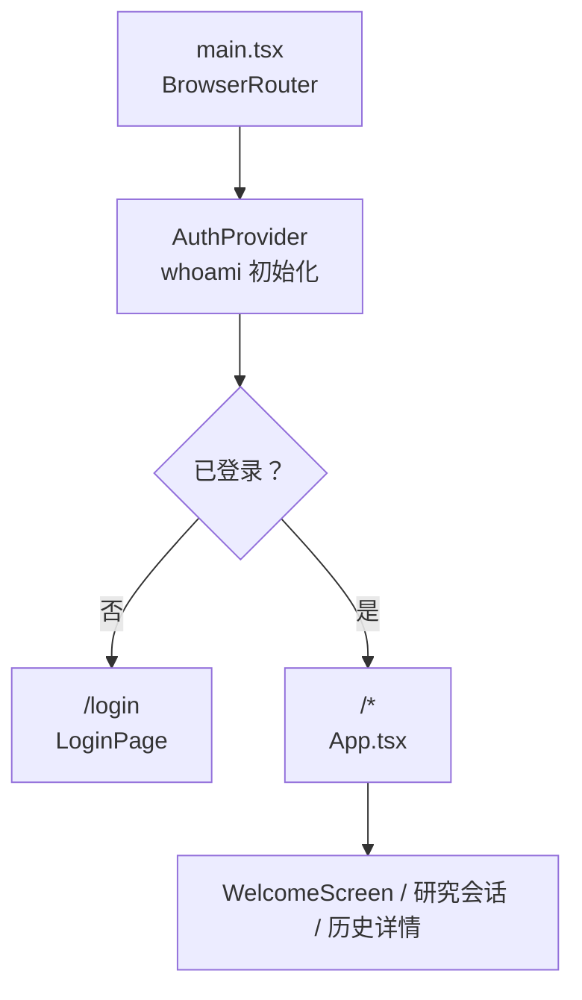

# 前端代码架构

> 更新时间：2026-11-17  
> 对应代码：`frontend/src`（27 个文件，4,395 行）  
> 运行入口：`http://localhost:12309/app/`

## 1. 技术栈

| 层次 | 选型 |
| --- | --- |
| 框架 | React 19、TypeScript 5.7 |
| 构建 | Vite 6.3、`tsc -b && vite build` |
| 路由 | React Router 7（`BrowserRouter`） |
| 样式 | Tailwind CSS 4、`tw-animate-css` |
| 组件 | Radix UI（Select、Tabs、ScrollArea、Tooltip、Slot） |
| 图标 | Lucide React |
| Markdown | `react-markdown` + `remark-gfm` |
| 后端通信 | 原生 `fetch` + `EventSource`；LangGraph SDK 仅保留为遗留 fallback |

## 2. 应用入口与路由



- `main.tsx` 挂载 `BrowserRouter`、`AuthProvider` 和两条路由。
- `/login` 由 `PublicRoute` 保护：已登录用户会跳回 `/`。
- `/*` 由 `ProtectedRoute` 保护：未登录用户跳转 `/login`。
- `BrowserRouter` 未设置 `basename`，`/app/` 前缀由 Nginx 的 `location /app/` 与静态资源路径处理；新增前端路由时需要同步检查 `frontend/nginx.conf`。
- 登录页只把“记住我”的用户名写入 `localStorage`（键 `zb02:remembered_username`），会话本身仍由 HttpOnly Cookie 保存，前端读不到 session。

## 3. 数据通道

当前前端有两条通道，主链路是 `useResearchStream`，`useStream` 是遗留 fallback。

### 3.1 主通道：`useResearchStream`

文件：[src/lib/useResearchStream.ts](./src/lib/useResearchStream.ts)

```text
InputForm / App
  → POST /api/research（fetch，credentials: include）
  → 拿到 task_id + stream_url
  → new EventSource(stream_url)
  → 事件写入 events / messages / status
```

要点：

- 首次提交生成任务；后续“确认计划”“补充要求”“历史续跑”都会复用 `taskIdRef.current`，把同一个 `task_id` 回传，让后端复用 LangGraph checkpoint。
- `EventSource` 建立后按事件类型更新阶段：计划、查询、检索、反思、提纲、初稿、评审、润色、定稿、暂停、错误。
- token 事件按 80ms 合并刷新，避免每个 token 触发整段 Markdown 重渲染。
- `finalize_answer` 结束本次流，把最终报告作为 AI 消息写入会话；`task_paused` 结束本次流，把计划作为 AI 消息展示，等待用户确认。
- 断线时最多计 10 次重连；超过后停止 loading，提示从历史记录继续查看。`stop()` 只停止当前页面接收，后台任务继续执行。
- `watchTask()` 用于从历史记录回到仍在后台运行的任务：先拉详情，再按间隔轮询；连续失败会停止，避免无限重试。
- `loadHistory()` 把历史消息、计划、待确认状态载入当前会话。

当前边界：

- 后端 SSE 只输出 `data:`，没有输出 `id:`，浏览器的 `Last-Event-ID` 不会真正携带；重连时可能从任务游标重新回放，前端会重复追加事件。修复方案见 [ADR-013](../docs/架构决策ADR/013-task-ownership-and-queue-reclaim.md)。
- 后端没有 heartbeat，Nginx `proxy_read_timeout 300s`，长节点空闲超过 5 分钟会断开。

### 3.2 遗留通道：`useStream`

文件：[src/App.tsx](./src/App.tsx)

`App.tsx` 仍初始化 `@langchain/langgraph-sdk/react` 的 `useStream`，并在 `App.tsx:427-464` 保留一段标注“已废弃”的 `thread.submit` fallback。后端是自建 FastAPI，不提供 `/threads`、`/runs`、`/assistants`，这条路径在当前部署下不可达。它仍然会把 LangGraph SDK 留在首屏依赖里（构建产物 `langgraph` 约 33KB / gzip 9.3KB），建议确认无历史依赖后删除。

## 4. 组件职责

| 文件 | 职责 |
| --- | --- |
| `src/main.tsx` | 路由、AuthProvider、登录态/加载态切换 |
| `src/App.tsx` | 研究会话状态机：提交、澄清、计划确认、取消、历史详情、事件到时间线映射 |
| `src/components/WelcomeScreen.tsx` | 欢迎页、历史入口、初始输入区 |
| `src/components/InputForm.tsx` | 问题输入、研究深度、模型选择；Enter 提交、Shift+Enter 换行、IME 组合输入保护 |
| `src/components/ClarificationCard.tsx` | 逐题需求澄清卡片，支持选项、自填、跳过 |
| `src/components/ChatMessagesView.tsx` | 普通对话消息、Markdown、正文内链接、计划确认 |
| `src/components/ResearchStreamChatView.tsx` | 研究流会话、流式正文、自动滚动、最后一条 AI 消息挂时间线 |
| `src/components/ActivityTimeline.tsx` | 研究步骤时间线，可折叠，中文步骤名与空态 |
| `src/components/HistoryList.tsx` | 历史列表，默认折叠，术语归一，标题兜底 |
| `src/components/HistoryDetailView.tsx` | 历史详情、步骤快照、运行中轮询、失败停止 |
| `src/components/LoginPage.tsx` | 登录表单、记住用户名、错误提示 |
| `src/context/AuthContext.tsx` | `login` / `logout` / `whoami` 状态 |
| `src/lib/useResearchStream.ts` | SSE Hook：提交、事件解析、token 合并、重连、watchTask、历史载入 |
| `src/lib/api.ts` | 模型列表、澄清、研究任务、历史接口封装；接口不可用时使用兜底模型列表 |
| `src/lib/auth.ts` | 登录、登出、whoami |
| `src/lib/datetime.ts` | 后端时间解析与相对时间 |
| `src/lib/utils.ts` | `cn()` 样式合并 |
| `src/components/ui/*` | Radix/Tailwind 基础组件：button、input、textarea、select、tabs、card、badge、scroll-area |

## 5. 状态与数据流

```text
AuthContext
  └─ loggedIn / username / userId

App.tsx
  ├─ researchStream: events / messages / status / streamingContent
  ├─ processedEventsTimeline: 当前会话时间线
  ├─ historicalActivities: 按消息 ID 缓存的历史时间线
  ├─ awaitingPlanConfirmation: unconfirmed / confirmed
  ├─ clarifySession: 澄清问题、已答列表、loading
  └─ historyThreadId: 当前查看的历史线程

useResearchStream
  ├─ taskIdRef: 当前 thread_id
  ├─ planRef: 最近一次计划正文
  ├─ eventSourceRef: 当前 SSE 连接
  ├─ messagesRef / eventsRef: 避免闭包读到旧状态
  └─ reconnectAttemptsRef: 重连计数
```

页面状态切换：

- 无会话、无历史详情 → 欢迎页。
- 有澄清会话 → 澄清卡片。
- 有研究流或普通消息 → 会话视图。
- 点击历史记录 → 历史详情；返回后回到欢迎页或当前会话。

## 6. 样式与交互

- `global.css` 定义 Tailwind v4 主题、深色背景、动画和滚动条样式。
- 深色 UI 为既定风格，本轮不做整体换肤，只做可读性、焦点态、触控区和滚动条修正。
- `scroll-area.tsx` 的垂直滚动条宽度为 `w-2`，同时修正了 Radix 与原生滚动条的可见度。
- 输入框保留 `focus-visible` 描边；按钮、历史行、时间线标题都有 `aria-expanded` / `aria-label` 等可访问性属性。
- Markdown 正文中的链接可点击，长链接不会撑破气泡；历史标题和问题都有截断/兜底。

## 7. 构建与端口

| 项 | 值 |
| --- | --- |
| 开发代理 | `VITE_API_PROXY_TARGET`，默认 `http://127.0.0.1:12409` |
| 代理路径 | `/api`、`/threads`、`/runs`、`/assistants`（后三者仅为兼容遗留 SDK，后端不存在） |
| 生产入口 | Nginx `12309`，静态资源在 `/app/`，`/api` 反代到 backend `2024` |
| 构建命令 | `npm run build`（`tsc -b && vite build`） |
| 分包 | `react`、`markdown`、`langgraph` 三个 manualChunks |
| 最近产物 | 主包 462.42KB / gzip 146.59KB；Markdown 157.76KB / 47.94KB；LangGraph 33.09KB / 9.30KB；React 11.83KB / 4.20KB；CSS 50.28KB / 9.24KB |

`frontend/src/lib/api.ts` 的 `API_BASE_URL` 为空字符串，所有请求走同源相对路径，由 Vite 开发代理或 Nginx 转发，避免跨域和 Cookie 丢失。

## 8. 已知问题

| 问题 | 影响 | 处理 |
| --- | --- | --- |
| SSE 无 `id:` 字段 | 浏览器重连不带真实 `Last-Event-ID`，可能重复回放 | 后端补 `id:`，见 ADR-013 |
| SSE 无 heartbeat | 空闲超过 300s 被 Nginx 断开 | 后端补心跳 |
| 遗留 `useStream` fallback | 不可达代码，增加包体与理解成本 | 确认后删除 |
| `BrowserRouter` 无 `basename` | 新增路由需同步 Nginx | 保持现状并在 README 说明 |
| 历史详情轮询 | 运行中任务每 3 秒请求详情 | 失败即停，避免无限轮询 |
